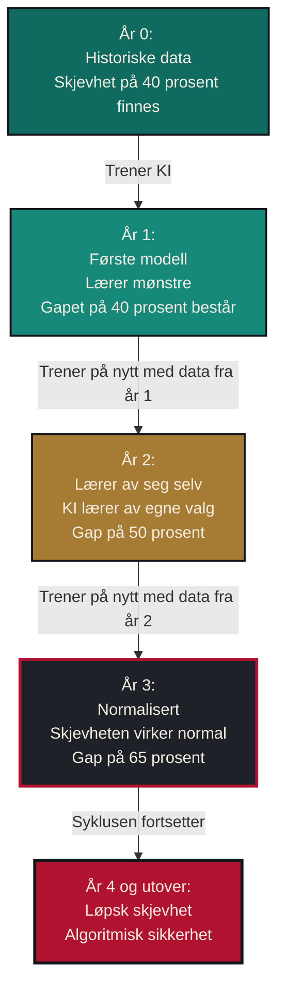

+++
date = "2026-11-09"
# Draft until it is published next week. Before publishing: set the date,
# remove draft, and add the nb-NO translations pair back to the English post.
draft = true
title = "Bruker dere KI i rekruttering? Slik arver algoritmene våre fordommer"
seoTitle = "KI i rekruttering: algoritmer arver fordommer"
slug = "ki-diskriminering-rekruttering-norge"
description = "Norske arbeidsgivere tar i bruk KI i rekruttering. UiO og Likestillings- og diskrimineringsombudet viser hvordan fordommer arves og forsterkes."
summary = "Norske arbeidsgivere tar i bruk KI i rekruttering. UiO og Likestillings- og diskrimineringsombudet viser hvordan fordommer arves og forsterkes."
tags = ["AI", "Ethics", "Machine Learning", "Norway"]
categories = ["Product"]
series = ["AI Ethics", "Opinion"]
images = ["/brand/og-ai-hiring-norway.png"]
mermaid = true
lang = "nb-NO"
ogLocale = "nb_NO"
xdefault = "/posts/ai-discrimination-norwegian-hiring/"

[[translations]]
lang = "nb-NO"
href = "/posts/ki-diskriminering-rekruttering-norge/"

[[translations]]
lang = "en"
href = "/posts/ai-discrimination-norwegian-hiring/"
+++

Kunstig intelligens (KI) endrer hvordan bedrifter ansetter folk. Det skjer overalt, også i Norge.

Norge har et godt rykte når det gjelder likestilling. Likevel viser [NAVIGATE, en forskningsserie ved UiO](https://www.sv.uio.no/iss/english/research/projects/navigate/), tydelig at etniske minoriteter blir diskriminert i rekrutteringsprosesser. Nå bruker stadig flere bedrifter KI og maskinlæring til å sortere jobbsøknader. Da oppstår et alvorlig problem. Systemene lærer av fortiden, og dataene fra fortiden går rett inn i nåtiden med de samme fordommene.

Når KI trenes på mange års ansettelsesdata, er dataene preget av tiår med underrepresentasjon av kvinner, innvandrere og søkere fra distriktene. Da lærer modellen at disse skjevhetene er normalt. Algoritmene skaper ikke ny diskriminering. De arver vår.

Du tenker kanskje at dette er en teknisk feil eller dårlig design. Som regel er det ikke det. KI-systemene lærer det vi har lært dem, gjennom våre egne skjeve beslutninger.

Dette er viktig fordi KI i rekruttering er klassifisert som et **«høyrisikosystem»** i EUs KI-forordning. Det er en anerkjennelse av at slike verktøy kan skade liv og karrierer. [Rapporten fra Likestillings- og diskrimineringsombudet (LDO) fra 2024](https://ldo.no/content/uploads/2025/05/Algorithms-artificial-intelligence-and-discrimination-report.pdf) om algoritmer og diskriminering peker på akkurat denne bekymringen.

Her forklarer jeg hvordan dette kan gjøre rekruttering i Norge dårligere, og hva vi kan gjøre med det.

## Historier fra virkeligheten

Jeg har hørt folk fortelle at de bytter navn på CV-en for å få en rettferdig sjanse til intervju. Unge fagfolk med innvandrerbakgrunn tar i bruk mer «norskklingende» navn, bare for å bli vurdert.

Dette er ingen skrøne. [En studie fra 2023 av Thiyagarajah og Orupabo](https://samfunnsforskning.brage.unit.no/samfunnsforskning-xmlui/bitstream/handle/11250/3096863/thiyagarajah-orupabo-2023-promoting-norwegianess-to-get-a-foot-in-the-door-stigma-management-among-young-ethnic%2b%25282%2529.pdf) dokumenterte at jobbsøkere med minoritetsbakgrunn systematisk tonet ned bakgrunnen sin for å få «en fot innenfor». Feltforsøk viser at søkere med innvandrerbakgrunn får betydelig færre tilbakemeldinger, selv med identiske kvalifikasjoner ([Midtbøen, 2016](https://www.sv.uio.no/iss/english/research/projects/navigate/)).

## Slik forsterkes skjevheten

Jeg har brukt mange år på å lære hvordan maskinlæringsmodeller lærer av data, og hva det betyr teknisk og etisk. Når en modell tar ansettelsesbeslutninger, oppstår det over tid noe vi kaller «bias amplification», altså forsterkning av skjevhet. Det er avgjørende å forstå denne tilbakekoblingen.

Slik kan syklusen se ut, som et eksempel:

**År 0: Utgangspunktet**  
En bedrift bygger et KI-system for ansettelser på historiske data. Dataene inneholder allerede skjevhet. Kvinner fra Nord-Norge fikk 40 prosent færre intervjuer enn like kvalifiserte menn fra Oslo da mennesker sto for utvelgelsen.

**År 1: Første modell**  
Modellen lærer av den skjeve historien. Den ser mønstre: «Vellykkede kandidater er ofte menn fra Oslo. Kvinner fra Tromsø er sjeldne blant tidligere ansatte.» Modellen gjør prediksjoner basert på disse mønstrene. Gapet består på 40 prosent.

**År 2: Forsterkningen begynner**  
Bedriften trener modellen på nytt for å «forbedre» den, med data fra år 1. Men dataene fra år 1 inneholder nå KI-ens egne skjeve beslutninger. Modellen lærer av seg selv. Mønsteret blir sterkere. Gapet vokser til 50 prosent.

**År 3: Diskrimineringen blir normalisert**  
Enda en runde med ny trening. Nå har modellen to år med egne skjeve resultater i treningsdataene. Algoritmen har lært at forskjellen er «normal». Gapet når 65 prosent.

**År 4 og utover: Skjevheten løper løpsk**  
For hver runde blir skjevheten sterkere, fordi modellen lærer av sine egne skjeve resultater. Det som startet som et speil av menneskelige fordommer, blir til algoritmisk sikkerhet.

Trener en bedrift modellene sine på nytt hvert kvartal eller hvert år for å «bedre ytelsen», og ingen griper inn, bygger den i praksis forsterkningsmaskiner uten å vite det.

## Et eksempel fra norsk teknologibransje

Kvinner utgjør omtrent 49 prosent av befolkningen i Norge ([SSB, befolkning etter kjønn](https://www.ssb.no/en/befolkning/folketall/statistikk/befolkning)). Likevel er bare omtrent 22 prosent av de som jobber i IT-yrker kvinner ([SSB, mange flere har IT-yrker](https://www.ssb.no/arbeid-og-lonn/sysselsetting/artikler/mange-flere-har-it-yrker)). Kontrasten viser tydelig underrepresentasjon i teknologibransjen.

Trenes en KI-modell for rekruttering på slike historisk skjeve data, lærer den ofte at «vellykkede kandidater» ser ut som flertallsgruppen. Kvalifiserte søkere fra underrepresenterte regioner eller grupper kan dermed bli behandlt som statistisk uvanlige av modellen. For hver ny treningsrunde blir ulempen større. Denne mekanismen er godt dokumentert i forskning på algoritmisk rettferdighet ([Barocas & Selbst, 2016](https://papers.ssrn.com/sol3/papers.cfm?abstract_id=2477899), [Raghavan et al., 2020](https://dl.acm.org/doi/10.1145/3351095.3372828)).

## Teknologi og regelverk møtes

Da er vi framme ved regelverket. Norge og EU er på vei mot krav om at KI-systemer skal oppfylle standarder for rettferdighet. KI-forordningen tar spesifikt for seg skjevhet i høyrisikoanvendelser som rekruttering. [Én av fire norske bedrifter bruker nå KI](https://practiceguides.chambers.com/practice-guides/artificial-intelligence-2025/norway/trends-and-developments). Dette er derfor ikke en fjern bekymring. Det skjer akkurat nå.

## Løsning: Start enkelt med omvekting

Det finnes flere teknikker og flere steder å gripe inn. Her ser vi på omvekting (reweighting), en av forbehandlingsteknikkene. Senere i artikkelserien tar jeg for meg teknikker under og etter selve modelltreningen.

Etter å ha studert tiltak for rettferdighet har jeg funnet at du ikke trenger å starte med kompliserte løsninger. Det finnes avanserte metoder for ulike mål, som demografisk paritet, like muligheter og individuell rettferdighet. Det enkleste tiltaket som faktisk virker, heter omvekting.

Tenk deg dette. Du trener en modell til å kjenne igjen «kvalifiserte kandidater», men treningsdataene er sterkt skjeve:

**Før omvekting:**

Alle kandidater bidrar like mye til det modellen lærer, uansett bakgrunn:

* Mannlig kandidat fra Oslo: vekt = 1,0
* Kvinnelig kandidat fra Oslo: vekt = 1,0  
* Mannlig kandidat fra Tromsø: vekt = 1,0
* Kvinnelig kandidat fra Tromsø: vekt = 1,0

**Etter omvekting:**

Vi justerer hvor mye modellen lærer av hver gruppe, for å jevne ut representasjonen:

* Mannlig kandidat fra Oslo: vekt = 0,7 *(reduserer overrepresentasjon)*
* Kvinnelig kandidat fra Oslo: vekt = 1,1 *(balanserer kjønn i flertallsregionen)*
* Mannlig kandidat fra Tromsø: vekt = 2,0 *(løfter underrepresentert geografi)*
* Kvinnelig kandidat fra Tromsø: vekt = 3,5 *(tar hensyn til sammensatt ulempe)*

Slik lærer modellen at en «typisk kvalifisert kandidat» ikke bare er en som ligner på det historiske flertallet. Systemet slutter å behandle «vanligst» som «best kvalifisert».

## Veien videre

Juridisk analyse fra Likestillings- og diskrimineringsombudet fra 2024 slår fast at dagens diskrimineringslovgivning må revideres for å ta høyde for algoritmiske systemer. Ombudet peker på KI i rekruttering som en hovedbekymring, fordi det er klassifisert som en høyrisikoanvendelse i EU-regelverket.

Slik jeg ser det, vil framtiden for KI i norsk rekruttering formes av tre krefter.

For det første presset fra regelverket, gjennom [KI-forordningen](https://artificialintelligenceact.eu/high-level-summary/). Den klassifiserer KI-systemer for rekruttering og arbeidsforhold som *høyrisiko*. Det betyr strenge krav til åpenhet, datakvalitet og rettferdighet.

For det andre en økende nasjonal bevissthet om algoritmisk diskriminering, understreket i flere undersøkelser fra [Likestillings- og diskrimineringsombudet](https://ldo.no/content/uploads/2025/05/Algorithms-artificial-intelligence-and-discrimination-report.pdf).

Til slutt de virksomhetene som innfører tiltak for rettferdighet på eget initiativ, i stedet for å vente til kravene blir obligatoriske.

Det er klart at forsterkning av skjevhet i KI ikke bare er en abstrakt risiko. Den finnes i virkelige datasett og i virkelige bedrifter, akkurat nå. Det oppmuntrende er at det finnes praktiske løsninger.

Vi som bygger KI-systemer har et ansvar for at modellene våre ikke forsterker de ulikhetene vi sier at vi vil fjerne. Det starter med å erkjenne problemet, forstå mekanismene og ta konkrete skritt mot rettferdighet.

---

**Hvilke erfaringer har du med KI i rekruttering? Har du sett disse mønstrene på norske arbeidsplasser? Jeg vil gjerne høre hva du mener.**

*Dette er den første artikkelen i en serie om rettferdighet i KI. Er du interessert i teknologi, rettferdighet i KI-systemer og geopolitikk, er du velkommen til å koble deg til meg på LinkedIn.*

**#KIEtikk #Norge #Rekruttering #Maskinlæring #Mangfold #RettferdigKI #NorskArbeidsliv**

---

 
 

________________________

Liker du å holde deg oppdatert på teknologi, forretning og universet? Du kan lese meg på Substack.

<iframe src="https://pysaurav.substack.com/embed" width="480" height="320" style="border:1px solid #EEE; background:white;" frameborder="0" scrolling="no"></iframe>

*Først publisert på engelsk: [Using AI for recruitment in Norway?](/posts/ai-discrimination-norwegian-hiring/)*
